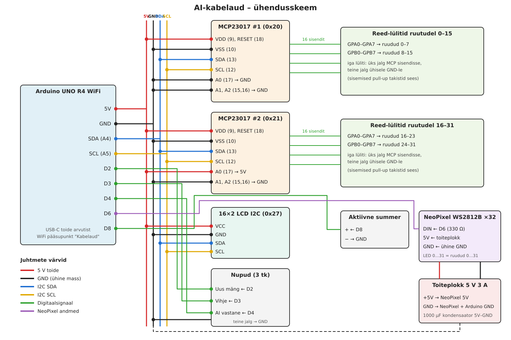
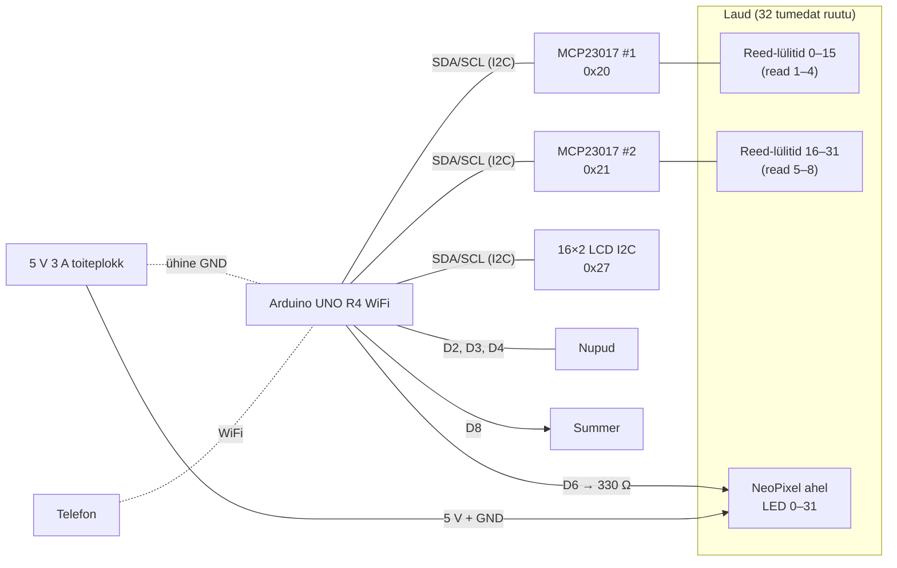

# AI-kabelaud

**Õppeaine:** IFI6203.DT Robootika
**Autor(id):** [täida nimed siia]
**Aasta / semester:** 2026 sügis

## 1. Projekti eesmärk ja seadme lühikirjeldus

Meie projekti eesmärk on luua 3D-prinditud kabelaud, mis tuvastab ise iga tehtud käigu ja annab mängijale kohe tagasisidet, kui hea see käik oli.

Iga tumeda ruudu all on reed-lüliti ja iga nupu põhjas magnet, nii et laud teab, millistel ruutudel nupud on. Arduino UNO R4 WiFi loeb andureid ning saadab laua seisu WiFi kaudu telefoni rakendusse. Rakenduses töötav AI (minimax-algoritm) hindab käiku ja tulemus kuvatakse laua serval olevale LCD-ekraanile, näiteks "Hea käik" või "Viga, parem oli e3-f4". NeoPixel LED-id ruutude all näitavad tehtud käiku, paremat käiku ja AI-vastase käiku.

**Millist probleemi see lahendab:** algaja kabemängija ei saa mängu ajal teada, kas tema käik oli hea või halb. Arvutis mängides kaob füüsilise laua tunne. AI-kabelaud ühendab päris lauamängu ja arvuti analüüsi: mängid päris nuppudega ning saad kohe treeneri moodi tagasisidet. Laud sobib ka üksi harjutamiseks AI-vastase vastu.

**Peamised komponendid:** Arduino UNO R4 WiFi, 32 reed-lülitit, 2 × MCP23017 I/O-laiendit, 16×2 I2C LCD, 32 NeoPixel LED-i, 3 nuppu, summer, 3D-prinditud laud ja nupud magnetitega.

Mängitakse **vene kabet** (8×8 laud, 12 nuppu kummalgi, lihtnupp lööb ka tagasi, tamm liigub mitu ruutu).

## 2. Sisendite loetelu

| Sisend | Füüsiline allikas | Kuidas loetakse |
|---|---|---|
| Nupu olemasolu igal 32 tumedal ruudul | Reed-lüliti ruudu all, sulgub nupu põhjas oleva magneti toimel | MCP23017 sisend (INPUT_PULLUP), Arduino loeb I2C kaudu |
| Nupp "Uus mäng" | Surunupp laua konsoolil | Arduino digitaalviik D2 (INPUT_PULLUP) |
| Nupp "Vihje" | Surunupp laua konsoolil | Arduino digitaalviik D3 (INPUT_PULLUP) |
| Nupp "AI vastane" | Surunupp laua konsoolil | Arduino digitaalviik D4 (INPUT_PULLUP) |
| Rakenduse käsud (mida LCD-l ja LED-idel näidata) | Telefon, WiFi | UNO R4 WiFi veebiserver, JSON-API |

## 3. Väljundite loetelu

| Väljund | Komponent |
|---|---|
| Käigu hinnang ja teated ("Hea käik", "Löömine kohustuslik!", "AI: g7-h6") | 16×2 I2C LCD-ekraan |
| Tehtud käik (oranž), parem käik / vihje (roheline), AI käik (sinine), viga (punane) | 32 NeoPixel (WS2812B) LED-i tumedate ruutude all |
| Helisignaal (käik tuvastatud, viga, AI käik) | Aktiivne summer |
| Laua seis ja nuppude vajutused telefoni | WiFi (UNO R4 WiFi pääsupunkt) |

## 4. Nõuded loodavale seadmele

**Käigu tuvastamine**
- Kui mängija tõstab nupu üles, siis laud ootab ega tee veel järeldust.
- Kui laud on vähemalt 0,8 s muutumatu, siis loetakse käik lõppenuks ja seis saadetakse rakendusse.
- Kui uus seis vastab täpselt ühele legaalsele käigule, siis käik kinnitatakse ja summer piiksub korra.
- Kui uus seis ei vasta ühelegi legaalsele käigule ja püsib üle 4 s, siis LCD näitab "Vigane seis", punased LED-id näitavad üleliigseid nuppe ja hallid puuduvaid nuppe ning summer piiksub kaks korda.
- Kui mängija tegi tavakäigu, kuigi löömine oli kohustuslik, siis LCD näitab "Löömine on kohustuslik!" ja punased LED-id näitavad nuppe, mis saavad lüüa.
- Kui mängija lööb mitu nuppu järjest, siis laud ootab, kuni kõik löödud nupud on eemaldatud, ja tuvastab kogu löögiseeria ühe käiguna.
- Kui lihtnupp jõuab viimasele reale, siis muutub see tammiks (rakendus jätab selle meelde, nupule pannakse peale kroon).

**Käigu hindamine**
- Pärast iga käiku arvutab AI parima käigu ja võrdleb sellega mängija käiku.
- Hinnang kuvatakse LCD 1. real: "Parim käik!", "Hea käik", "Ebatäpsus", "Viga" või "Suur viga" (vastavalt sellele, kui palju punkte käik kaotas, 100 punkti = üks nupp).
- Kui oli olemas parem käik, siis LCD 2. real on "Parem: e3-f4" ja vastavad ruudud süttivad roheliselt; tehtud käigu ruudud süttivad oranžilt.
- Kui käik oli suur viga, siis summer piiksub kaks korda.

**Nupud**
- Kui vajutatakse "Uus mäng" ja nupud on algseisus, siis algab uus mäng ja LCD näitab "Uus mäng / Valge alustab".
- Kui vajutatakse "Uus mäng" ja nupud ei ole algseisus, siis LCD näitab "Pane nupud algseisu", LED-id näitavad valesid ruute ja mäng algab automaatselt, kui seis on õige.
- Kui vajutatakse "Vihje", siis näidatakse käigul oleva poole parimat käiku rohelise LED-iga ja LCD-l.
- Kui vajutatakse "AI vastane", siis lülitub AI-vastane sisse või välja. Kui AI on sees, mängib AI musta poolt.

**AI-vastane**
- Kui on AI käik, siis LCD näitab "AI: g7-h6 / Liiguta nuppu", sinised LED-id näitavad algus- ja lõppruutu ning punased LED-id löödavaid nuppe.
- Kui mängija liigutab AI nupu valesti, siis LCD näitab "Vale käik!" ja AI käik jääb ootele.

**Mängu lõpp ja töökindlus**
- Kui käigul oleval poolel pole ühtegi legaalset käiku, siis LCD näitab "Valge võitis!" või "Must võitis!" ja kõik LED-id süttivad roheliselt.
- Kui rakendus pole ühendatud, siis töötab laud testirežiimis: LCD näitab nuppude arvu ja viimati muutunud ruutu ning "Uus mäng" kontrollib algseisu.
- Kui MCP23017 laiendit ei leita, siis LCD näitab viga ja summer annab märku.

## 5. Süsteemi füüsiliste komponentide loetelu

| Komponent | Kogus | Märkus |
|---|---|---|
| Arduino UNO R4 WiFi | 1 | mikrokontroller, WiFi ja veebiserver |
| Reed-lüliti, normaalselt avatud, 2×14 mm | 32 (+8 varu) | alternatiiv: A3144 Halli andur |
| MCP23017 I/O-laiendi (DIP-28 või moodul) | 2 | aadressid 0x20 ja 0x21 |
| 16×2 LCD I2C liidesega | 1 | aadress 0x27 |
| WS2812B NeoPixel LED (riba 60 LED/m) | 32 | valikuline, eraldi 5 V toide |
| Surunupp | 3 | Uus mäng, Vihje, AI vastane |
| Aktiivne summer 5 V | 1 | |
| Neodüümmagnet 8×3 mm | 24 (+6 varu) | iga nupu põhja |
| 5 V 3 A toiteplokk | 1 | NeoPixelite jaoks |
| Kondensaator 1000 µF, takisti 330 Ω | 1 + 1 | NeoPixelite kaitseks |
| Takisti 4,7 kΩ | 2 | I2C pull-up (kui moodulitel pole) |
| 3D-prinditud laud (4 osa), nupud (24 tk), kroonid, konsool | – | STL-failid lisatakse kausta `hardware/3d/` |

## 6. Ühendusskeem





**Ühendused**

| Arduino UNO R4 WiFi viik | Ühendatakse | Märkus |
|---|---|---|
| 5V | MCP23017 #1 ja #2 VDD (viik 9), RESET (viik 18), LCD VCC | |
| GND | MCP23017 VSS (viik 10), LCD GND, kõigi reed-lülitite teine jalg, nuppude teine jalg, summeri miinus | ühine mass |
| SDA (A4) | MCP23017 #1 ja #2 SDA (viik 13), LCD SDA | I2C siin, 4,7 kΩ pull-up 5 V-le |
| SCL (A5) | MCP23017 #1 ja #2 SCL (viik 12), LCD SCL | I2C siin, 4,7 kΩ pull-up 5 V-le |
| D2 | nupp "Uus mäng" | teine jalg GND |
| D3 | nupp "Vihje" | teine jalg GND |
| D4 | nupp "AI vastane" | teine jalg GND |
| D6 | NeoPixel DIN läbi 330 Ω takisti | |
| D8 | summeri pluss | |

- **MCP23017 aadressid:** #1 A0, A1, A2 (viigud 15–17) → GND = 0x20; #2 A0 → 5 V, A1 ja A2 → GND = 0x21.
- **Reed-lülitid:** iga lüliti üks jalg MCP23017 sisendisse, teine ühisele GND-le. Andur `i` = MCP #1 (i < 16) või MCP #2 (i ≥ 16), viik GPA0–GPA7 = 0–7, GPB0–GPB7 = 8–15. Sisemised pull-up takistid on sees, lisatakisteid pole vaja.
- **Ruudu number:** `i = rida × 4 + veerg / 2`, kus rida 0–7 on read 1–8 (rida 1 on LCD poolt) ja veerg 0–7 on a–h. Näiteks a1 = 0, c1 = 1, b2 = 4, h8 = 31. Sama numeratsioon kehtib anduritele ja NeoPixelitele.
- **NeoPixelid:** 32 LED-i järjestikku samas järjekorras (0 → 31). 5 V ja GND tulevad toiteplokist, 1000 µF kondensaator toite otsas, toiteploki GND ühendatud Arduino GND-ga. Arduino 5 V viiku NeoPixelite toiteks mitte kasutada.

## 7. Süsteemi juhtiv kood (pseudokood)

Kood lisatakse kausta `src/`. Süsteem koosneb kahest osast: Arduino püsivara loeb andureid ja juhib väljundeid, telefonirakendus sisaldab kabe reegleid ja AI-d (need on mikrokontrolleri jaoks liiga mahukad).

**Arduino (src/kabelaud/kabelaud.ino)**

```
setup:
  seadista nupud (INPUT_PULLUP), summer, LCD, NeoPixelid
  seadista mõlemad MCP23017 – kõik 16 viiku INPUT_PULLUP
  käivita WiFi pääsupunkt "Kabelaud" ja veebiserver
  näita LCD-l võrgu nime ja IP-aadressi

loop (iga 15 ms):
  loe mõlemast MCP23017-st 16 bitti -> 32-bitine ruutude olek
  iga ruudu kohta: muutus kehtib, kui see püsib 4 lugemist (värelemise filter)
  kui ükski ruut pole 800 ms muutunud -> laud stabiilne, suurenda loendurit seq
  loe nuppe; vajutuse korral suurenda nupu loendurit
  kui rakendus pole ühendatud -> testirežiim (LCD: nuppude arv, viimane muutunud ruut)
  teeninda veebipäringuid:
    GET  /api/state -> {"s":"1111…0000", "stable":true, "seq":5, "b":[0,1,0]}
    POST /api/show  <- {"l1":"Hea käik","l2":"Parem: e3-f4","leds":"00a0t…","beep":1}
                       kuva tekst LCD-l, värvi LED-id, piiksu
```

**Telefonirakendus**

```
iga 250 ms: küsi /api/state
kui laud on stabiilne ja seis muutus:
  leia legaalne käik, mille järel laua seis oleks täpselt selline
  kui leiti:
    AI arvutab parima käigu (minimax + alfa-beeta kärpimine, kuni 10 käiku ette)
    kaotus = parima käigu hinnang − mängija käigu hinnang
    vali hinne: Parim käik / Hea käik / Ebatäpsus / Viga / Suur viga
    saada /api/show: hinne, parem käik, LED-id
    kui AI-vastane on sees -> arvuta AI käik ja näita seda LED-idega
  kui ei leitud ja seis püsib 4 s:
    kui oli kohustuslik löömine -> "Löömine on kohustuslik!"
    muidu -> "Vigane seis", näita valesid ruute
kui nupu loendur muutus -> uus mäng / vihje / AI sisse-välja
```

## Repo struktuur

```
README.md                         see dokumentatsioon
hardware/wiring-diagram.svg       ühendusskeem
hardware/3d/                      3D-prinditavad failid (lisatakse)
src/                              Arduino kood ja rakendus (lisatakse)
media/                            pildid ja videod
```
