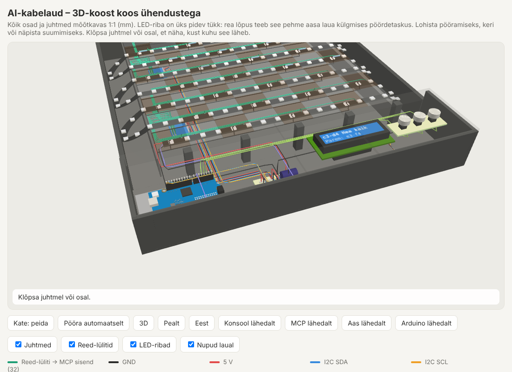
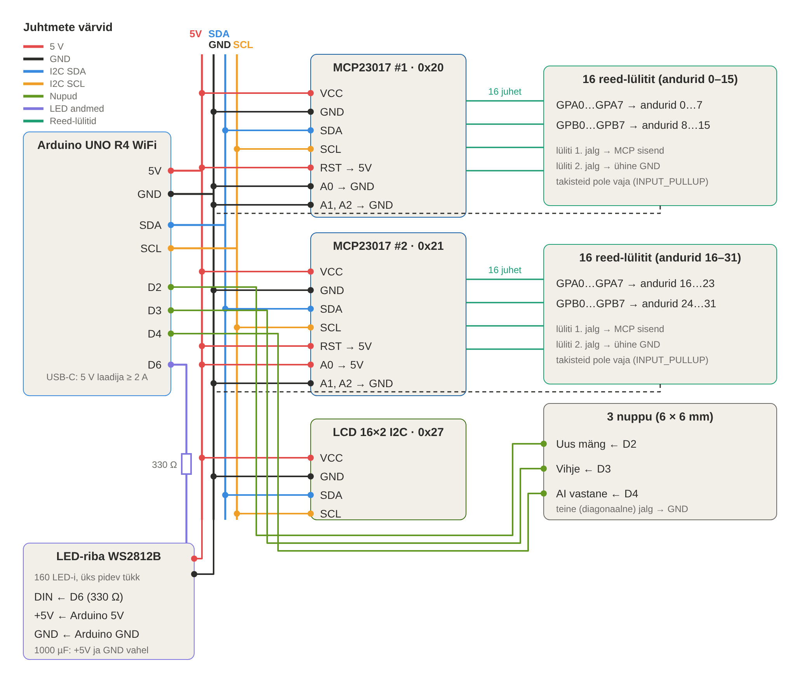
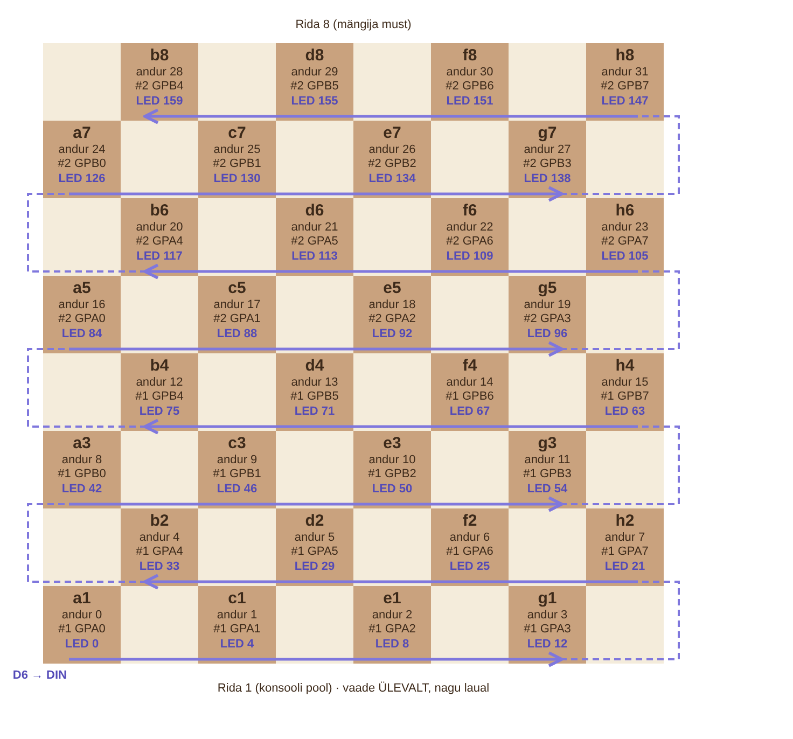
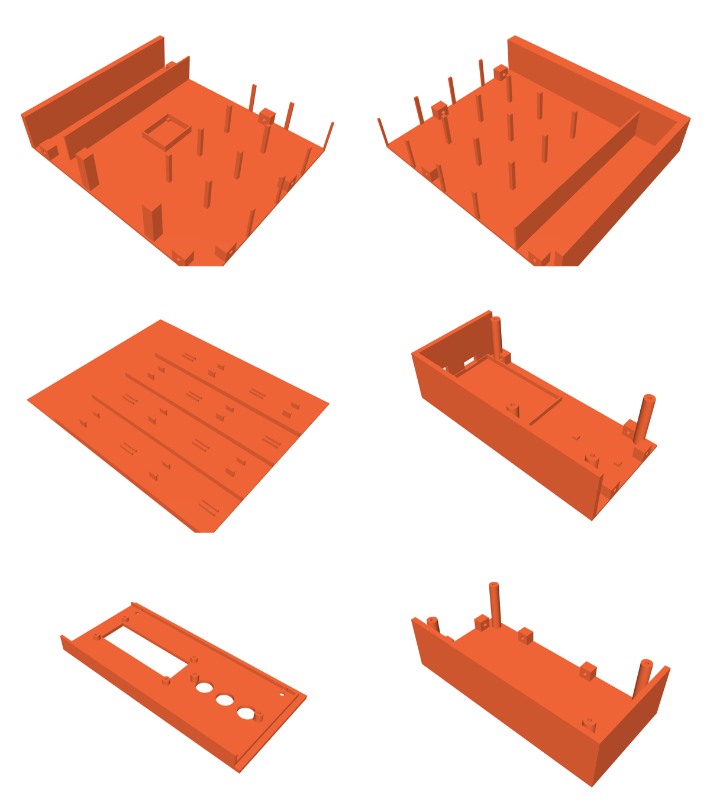

# AI-kabelaud

**Õppeaine:** IFI6203.DT Robootika
**Autor(id):** [täida nimed siia]
**Aasta / semester:** 2026 sügis



## 1. Projekti eesmärk ja seadme lühikirjeldus

Meie projekti eesmärk on luua 3D-prinditud kabelaud, mis tuvastab ise iga tehtud käigu ja annab mängijale kohe tagasisidet, kui hea see käik oli.

Iga tumeda ruudu all on reed-lüliti ja iga nupu põhjas magnet, nii et laud teab, millistel ruutudel nupud on. Arduino UNO R4 WiFi loeb andureid ning saadab laua seisu WiFi kaudu telefoni rakendusse. Rakenduses töötav AI (minimax-algoritm) hindab käiku ja tulemus kuvatakse laua serval olevale LCD-ekraanile, näiteks "Hea käik" või "Viga, parem oli e3-f4". LED-riba ruutude all näitab tehtud käiku, paremat käiku ja AI-vastase käiku.

**Millist probleemi see lahendab:** algaja kabemängija ei saa mängu ajal teada, kas tema käik oli hea või halb. Arvutis mängides kaob füüsilise laua tunne. AI-kabelaud ühendab päris lauamängu ja arvuti analüüsi: mängid päris nuppudega ning saad kohe treeneri moodi tagasisidet. Laud sobib ka üksi harjutamiseks AI-vastase vastu.

**Peamised komponendid:** Arduino UNO R4 WiFi, 32 reed-lülitit, 2 × MCP23017 I/O-laiendi moodul, 16×2 I2C LCD, WS2812B LED-riba (160 LED-i ühes tükis), 3 nuppu, 3D-prinditud laud, konsool ja nupud magnetitega.

Mängitakse **vene kabet** (8×8 laud, 12 nuppu kummalgi, lihtnupp lööb ka tagasi, tamm liigub mitu ruutu).

## 2. Sisendite loetelu

| Sisend | Füüsiline allikas | Kuidas loetakse |
|---|---|---|
| Nupu olemasolu igal 32 tumedal ruudul | Reed-lüliti ruudu all, sulgub nupu põhjas oleva magneti toimel | MCP23017 sisend (INPUT_PULLUP), Arduino loeb I2C kaudu |
| Nupp "Uus mäng" | 6 × 6 mm taktiilnupp konsoolil | Arduino digitaalviik D2 (INPUT_PULLUP) |
| Nupp "Vihje" | 6 × 6 mm taktiilnupp konsoolil | Arduino digitaalviik D3 (INPUT_PULLUP) |
| Nupp "AI vastane" | 6 × 6 mm taktiilnupp konsoolil | Arduino digitaalviik D4 (INPUT_PULLUP) |
| Rakenduse käsud (mida LCD-l ja LED-idel näidata) | Telefon, WiFi | UNO R4 WiFi veebiserver, JSON-API |

## 3. Väljundite loetelu

| Väljund | Komponent |
|---|---|
| Käigu hinnang ja teated ("Hea käik", "Löömine kohustuslik!", "AI: g7-h6") | 16×2 I2C LCD-ekraan |
| Tehtud käik (oranž), parem käik / vihje (roheline), AI käik (sinine), viga (punane) | WS2812B LED-riba, 32 LED-i tumedate ruutude all (ülejäänud kustu) |
| Laua seis ja nuppude vajutused telefoni | WiFi (UNO R4 WiFi pääsupunkt) |

## 4. Nõuded loodavale seadmele

**Käigu tuvastamine**
- Kui mängija tõstab nupu üles, siis laud ootab ega tee veel järeldust.
- Kui laud on vähemalt 0,8 s muutumatu, siis loetakse käik lõppenuks ja seis saadetakse rakendusse.
- Kui uus seis vastab täpselt ühele legaalsele käigule, siis käik kinnitatakse ja tehtud käigu LED-id vilguvad korra.
- Kui uus seis ei vasta ühelegi legaalsele käigule ja püsib üle 4 s, siis LCD näitab "Vigane seis", punased LED-id näitavad üleliigseid nuppe ja hallid puuduvaid nuppe.
- Kui mängija tegi tavakäigu, kuigi löömine oli kohustuslik, siis LCD näitab "Löömine on kohustuslik!" ja punased LED-id näitavad nuppe, mis saavad lüüa.
- Kui mängija lööb mitu nuppu järjest, siis laud ootab, kuni kõik löödud nupud on eemaldatud, ja tuvastab kogu löögiseeria ühe käiguna.
- Kui lihtnupp jõuab viimasele reale, siis muutub see tammiks (rakendus jätab selle meelde, nupule pannakse peale prinditud kroon).

**Käigu hindamine**
- Pärast iga käiku arvutab AI parima käigu ja võrdleb sellega mängija käiku.
- Hinnang kuvatakse LCD 1. real: "Parim käik!", "Hea käik", "Ebatäpsus", "Viga" või "Suur viga" (vastavalt sellele, kui palju punkte käik kaotas, 100 punkti = üks nupp).
- Kui oli olemas parem käik, siis LCD 2. real on "Parem: e3-f4" ja vastavad ruudud süttivad roheliselt; tehtud käigu ruudud süttivad oranžilt.

**Nupud**
- Kui vajutatakse "Uus mäng" ja nupud on algseisus, siis algab uus mäng ja LCD näitab "Uus mäng / Valge alustab".
- Kui vajutatakse "Uus mäng" ja nupud ei ole algseisus, siis LCD näitab "Pane nupud algseisu", LED-id näitavad valesid ruute ja mäng algab automaatselt, kui seis on õige.
- Kui vajutatakse "Vihje", siis näidatakse käigul oleva poole parimat käiku rohelise LED-iga ja LCD-l.
- Kui vajutatakse "AI vastane", siis lülitub AI-vastane sisse või välja. Kui AI on sees, mängib AI musta poolt.

**AI-vastane**
- Kui on AI käik, siis LCD näitab "AI: g7-h6 / Liiguta nuppu", sinised LED-id näitavad algus- ja lõppruutu ning punased LED-id löödavaid nuppe.
- Kui mängija liigutab AI nupu valesti, siis LCD näitab "Vale käik!" ja AI käik jääb ootele.

**Mängu lõpp ja töökindlus**
- Kui käigul oleval poolel pole ühtegi legaalset käiku, siis LCD näitab "Valge võitis!" või "Must võitis!" ja kõik ruutude LED-id süttivad roheliselt.
- Kui rakendus pole ühendatud, siis töötab laud testirežiimis: LCD näitab nuppude arvu ja viimati muutunud ruutu ning "Uus mäng" kontrollib algseisu.
- Kui MCP23017 laiendit ei leita, siis LCD näitab viga.
- LED-ide heledus on koodis piiratud (max 40/255), et kogu süsteemi voolutarve jääks alla ~500 mA ja kogu süsteemi saaks toita Arduino USB-C kaudu.

## 5. Süsteemi füüsiliste komponentide loetelu

Mõõdud on mõõdetud meie päris osadelt.

| Komponent | Kogus | Mõõdud / märkus |
|---|---|---|
| Arduino UNO R4 WiFi (läbipaistvas korpuses) | 1 | plaat 68,6 × 53,3 mm, korpusega 81 × 58 × 18 mm |
| Reed-lüliti, normaalselt avatud | 32 (+ varu) | klaas Ø 2 × 10,5 mm |
| MCP23017 I/O-laiendi moodul | 2 | 26,5 × 21 mm, aadressid 0x20 ja 0x21 |
| 16×2 LCD koos PCF8574 I2C moodulitaga | 1 | 80 × 35 × 19 mm, raam 72,3 × 23 mm, kinnitusaugud 75 × 31 mm, aadress 0x27 |
| WS2812B LED-riba, 60 LED/m | 1 tükk, 160 LED-i | 10 mm lai, samm 16,67 mm, pikkus ~2,67 m, **ei lõigata** |
| Taktiilnupp | 3 | 6 × 6 × 7 mm |
| Neodüümmagnet | 24 (+ varu) | Ø 6 × 2 mm |
| Takisti 330 Ω | 1 | LED-riba andmeliinil |
| Kondensaator 1000 µF | 1 | LED-riba toite stabiliseerimiseks |
| Jaotusplaat (jooteplaat) | 1 | 40 × 30 mm, 5V / GND / SDA / SCL siinid |
| Nupuplaat (jooteplaat) | 1 | 60 × 20 mm |
| USB-C telefonilaadija | 1 | 5 V, ≥ 2 A (ainus toiteallikas) |
| Kruvid | – | 16 × M3 × 16 + mutrid (liited), 8 × M3 × 12 peitpea (kaas), 6 × M2,5 × 6 (LCD, nupuplaat) |
| 3D-prinditud osad | 16 faili | vt [hardware/3d/PRINDIJUHEND.txt](hardware/3d/PRINDIJUHEND.txt) |

Kõik 3D-prinditavad osad (STL) on kaustas [`hardware/3d/`](hardware/3d/) ja need on tehtud ise. Prinditud Elegoo Centauri Carboniga (alus 256 × 256 mm); osad mahuvad ka Prusa MK3 alusele (250 × 210 mm).

| 3D-osa | Tükke | Mõõt (mm) |
|---|---|---|
| Laua alus (veerandid) | 4 | 169 × 144 × 33 |
| Pealmine plaat (veerandid, 1 mm mängupind) | 4 | 169 × 144 × 5,8 |
| Konsool (pooled) | 2 | 169 × 80 × 45 |
| Konsooli kaas (pooled) | 2 | 169 × 80 × 13,8 |
| Nupud (12 tk failis, prinditakse 2 värvis) | 24 | Ø 28 × 7 |
| Tammi kroonid / nupukatted / tumedad ruudud | 8 / 3 / 32 | – |
| Proovitükid (ruut + nupp anduri testimiseks) | – | [`hardware/3d/proovitukid/`](hardware/3d/proovitukid/) |

## 6. Ühendusskeem



Interaktiivne versioon koos ehitusjuhistega: [`docs/uhendusskeem.html`](docs/uhendusskeem.html) (ava brauseris).

| Arduino UNO R4 WiFi viik | Ühendub | Märkus |
|---|---|---|
| 5V | jaotusplaadi 5V siin → MCP #1 ja #2 VCC + RST, LCD VCC, LED-riba +5V | |
| GND | jaotusplaadi GND siin → kõik GND-d, reed-lülitite ühine juhe, nuppude 2. jalg | ühine mass |
| SDA | jaotusplaadi SDA siin → MCP #1, MCP #2, LCD | I2C |
| SCL | jaotusplaadi SCL siin → MCP #1, MCP #2, LCD | I2C |
| D2 | nupp "Uus mäng" | teine jalg GND |
| D3 | nupp "Vihje" | teine jalg GND |
| D4 | nupp "AI vastane" | teine jalg GND |
| D6 | 330 Ω → LED-riba DIN (riba algus a1 juures) | |

| MCP23017 viik | #1 (0x20) | #2 (0x21) |
|---|---|---|
| VCC, RST | 5V | 5V |
| GND, A1, A2 | GND | GND |
| A0 | GND | **5V** |
| SDA / SCL | I2C siin | I2C siin |
| GPA0–7, GPB0–7 | andurid 0–15 (read 1–4) | andurid 16–31 (read 5–8) |

- **Reed-lülitid:** iga lüliti üks jalg MCP sisendisse, teine ühisele GND-juhtmele. Sisemised pull-up takistid on sees, lisatakisteid pole vaja.
- **Ruudu ja anduri number:** `andur = rida × 4 + veerg / 2` (rida 0–7 = read 1–8, veerg 0–7 = a–h). Näiteks a1 = 0, c1 = 1, b2 = 4, h8 = 31.
- **LED-riba** on üks pidev tükk. Rea lõpus teeb see laua külgmises 30 mm pöördetaskus pehme aasa (~82 mm, 9 LED-i sammu) ja jätkub järgmises reas vastassuunas. Tumeda ruudu LED-i number on `21 × rida + 4 × k`, kus k on tumeda ruudu järjekorranumber reas riba suunas. Näiteks a1 = 0, h2 = 21, c3 = 46, b8 = 159.
- **Toide:** kogu süsteem saab toite Arduino USB-C kaudu (laadija 5 V, ≥ 2 A). 1000 µF kondensaator on jaotusplaadil 5V ja GND vahel.



**1:1 koostejoonis:** [`hardware/koostejoonis-1-1-A4.pdf`](hardware/koostejoonis-1-1-A4.pdf) – 4 A4 lehte, mis kokku kleebituna näitavad täpses suuruses kõigi osade, reed-lülitite, LED-riba ja juhtmete asukohti (prindi 100 % mõõtkavas).

## 7. Süsteemi juhtiv kood (pseudokood)

Kood lisatakse kausta `src/`. Süsteem koosneb kahest osast: Arduino püsivara loeb andureid ja juhib väljundeid, telefonirakendus sisaldab kabe reegleid ja AI-d (need on mikrokontrolleri jaoks liiga mahukad).

**Arduino**

```
setup:
  seadista nupud D2, D3, D4 (INPUT_PULLUP), LCD, LED-riba (160 LED-i, heledus 40)
  seadista mõlemad MCP23017 – kõik 16 viiku INPUT_PULLUP
  käivita WiFi pääsupunkt "Kabelaud" ja veebiserver
  näita LCD-l võrgu nime ja IP-aadressi

loop (iga 15 ms):
  loe mõlemast MCP23017-st 16 bitti -> 32-bitine ruutude olek
  iga ruudu kohta: muutus kehtib, kui see püsib 4 lugemist (värelemise filter)
  kui ükski ruut pole 800 ms muutunud -> laud stabiilne, suurenda loendurit seq
  loe nuppe; vajutuse korral suurenda nupu loendurit
  kui rakendus pole ühendatud -> testirežiim (LCD: nuppude arv, viimane muutunud ruut)
  teeninda veebipäringuid:
    GET  /api/state -> {"s":"1111…0000", "stable":true, "seq":5, "b":[0,1,0]}
    POST /api/show  <- {"l1":"Hea käik","l2":"Parem: e3-f4","leds":"00a0t…"}
                       kuva tekst LCD-l, värvi ruutude LED-id:
                       LED(ruut) = 21 × rida + 4 × k
```

**Telefonirakendus**

```
iga 250 ms: küsi /api/state
kui laud on stabiilne ja seis muutus:
  leia legaalne käik, mille järel laua seis oleks täpselt selline
  kui leiti:
    AI arvutab parima käigu (minimax + alfa-beeta kärpimine, kuni 10 käiku ette)
    kaotus = parima käigu hinnang − mängija käigu hinnang
    vali hinne: Parim käik / Hea käik / Ebatäpsus / Viga / Suur viga
    saada /api/show: hinne, parem käik, LED-id
    kui AI-vastane on sees -> arvuta AI käik ja näita seda LED-idega
  kui ei leitud ja seis püsib 4 s:
    kui oli kohustuslik löömine -> "Löömine on kohustuslik!"
    muidu -> "Vigane seis", näita valesid ruute
kui nupu loendur muutus -> uus mäng / vihje / AI sisse-välja
```

## 8. Mehaaniline ülesehitus



- **Laud:** 338 × 288 × 34 mm, mänguväli 268 × 268 mm, ruut 33,5 mm. Külgedel 30 mm pöördetaskud LED-riba aasade jaoks.
- **Kihid laua sees (alt üles):** põhi 0–2 mm · MCP23017 hällid · juhtmed ~27 mm · LED-riba 29–31 mm · reed-lülitid 31–33 mm · pealmine plaat 33–34 mm (1 mm mängupind, magnet sulgeb reed-lüliti läbi selle).
- **Pealmise plaadi all:** ribid ridade vahel (toetuvad sammastele), reed-lülitite juhikud (klaasi üks ots ruudu keskel) ja LED-riba klambrid heledate ruutude all.
- **Konsool:** 338 × 80 × 48 mm, laua ees. Laua ja konsooli vahel vaheseina pole; pealmise plaadi esiserv toetub tugipostidele. Vasakul seinas USB-C ja toitepesa ava, paremal kaanes LCD aken ja 3 nuppu.
- **Liited:** veerandid ja konsooli pooled kinnitatakse liiteklotside kaudu M3 kruvidega; liitekohad on ruutude servadel.

Interaktiivne 3D-koostemudel kõigi osade ja juhtmetega: [`docs/3d-koostemudel.html`](docs/3d-koostemudel.html) (ava brauseris; klõpsa juhtmel, et näha, kust kuhu see läheb). Mudeli, STL-failide ja joonise generaator on kaustas [`tools/3d/`](tools/3d/).

## Repo struktuur

```
README.md                          see dokumentatsioon
hardware/wiring-diagram.png/.svg   ühendusskeem
hardware/ruutude-kaart.png/.svg    ruutude, andurite ja LED-ide numeratsioon
hardware/koostejoonis-1-1-A4.pdf   1:1 koostejoonis (4 A4 lehte + kaaneleht)
hardware/3d/                       16 STL-faili + PRINDIJUHEND.txt
hardware/3d/proovitukid/           proovitükid anduri ja magneti testimiseks
docs/3d-koostemudel.html           interaktiivne 3D-koostemudel
docs/uhendusskeem.html             interaktiivne ühendusskeem koos ehitusjuhistega
tools/3d/                          3D-failide generaator (geom.py, parts.py, csg.cpp)
media/                             pildid
src/                               Arduino kood ja rakendus (lisatakse)
```
